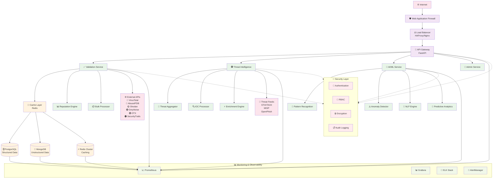
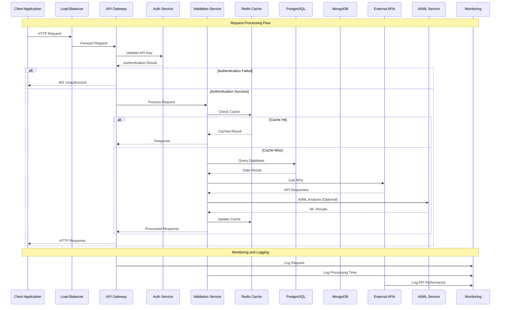
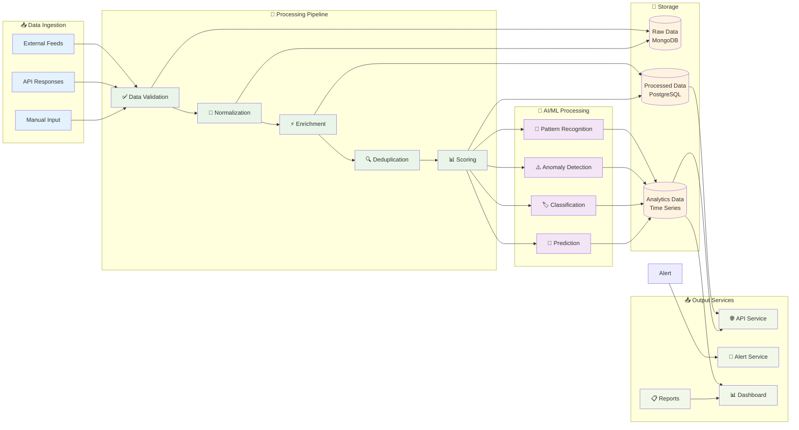
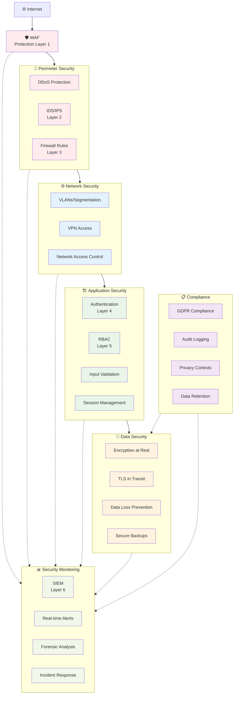
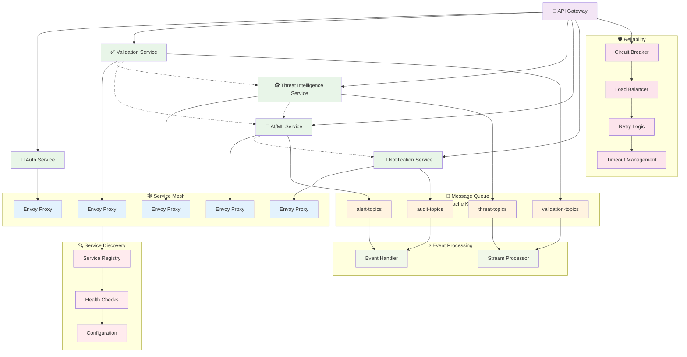
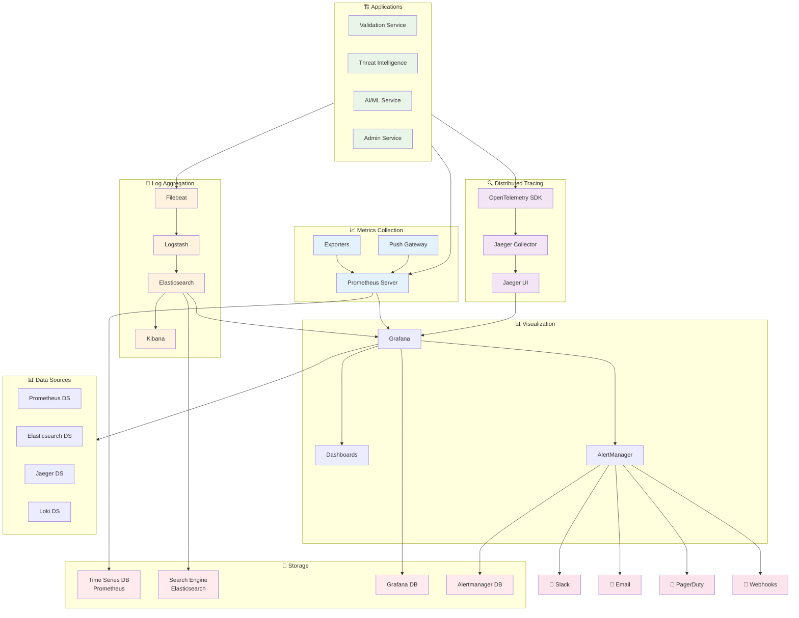
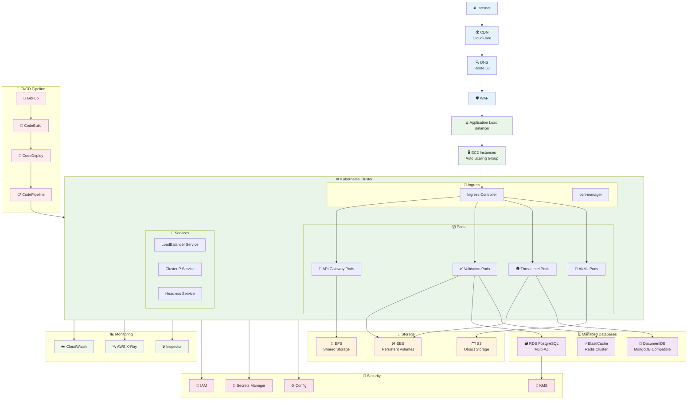
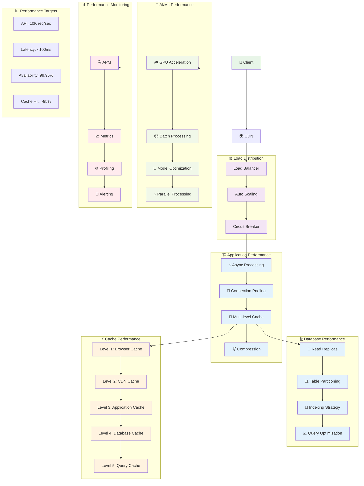
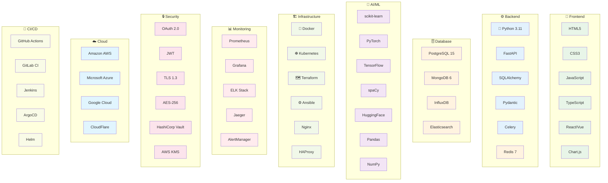

# Architecture Overview
## Cybersecurity Threat Intelligence Platform

---

## 🏗️ High-Level System Architecture

### System Overview Diagram



---

## 🔄 Data Flow Architecture

### Request Processing Flow



### Threat Intelligence Data Flow



---

## 🗄️ Database Architecture

### Hybrid Database Design

```mermaid
graph TB
    %% Application Layer
    subgraph Application[🏗️ Application Layer]
        API[API Gateway]
        Services[Business Services]
    end
    
    %% PostgreSQL - Structured Data
    subgraph PostgreSQL[🗄️ PostgreSQL Cluster]
        subgraph Users[(👤 User Management)]
            Users1[users]
            Users2[api_keys]
            Users3[sessions]
        end
        
        subgraph Validation[(✅ Validation Data)]
            Val1[validation_results]
            Val2[validation_logs]
            Val3[bulk_jobs]
        end
        
        subgraph Threat[(🕵️ Threat Intelligence)]
            Threat1[threat_indicators]
            Threat2[threat_sources]
            Threat3[threat_correlation]
        end
        
        subgraph Audit[(📋 Audit & Logs)]
            Audit1[audit_logs]
            Audit2[system_logs]
            Audit3[security_events]
        end
    end
    
    %% MongoDB - Unstructured Data
    subgraph MongoDB[🍃 MongoDB Cluster]
        subgraph RawData[(📄 Raw Data)]
            Raw1[threat_reports]
            Raw2[external_responses]
            Raw3[detailed_logs]
        end
        
        subgraph Documents[(📃 Documents)]
            Doc1[validation_documents]
            Doc2[user_sessions]
            Doc3[system_metrics]
        end
        
        subgraph Collections[(🗂️ Collections)]
            Coll1[threat_intelligence]
            Coll2[validation_logs]
            Coll3[external_api_logs]
        end
    end
    
    %% Redis - Caching
    subgraph Redis[⚡ Redis Cluster]
        subgraph CacheLevels[📊 Cache Levels]
            Cache1[L1: API Response<br/>TTL: 5min]
            Cache2[L2: Reputation<br/>TTL: 1hr]
            Cache3[L3: Blacklist<br/>TTL: 24hr]
            Cache4[L4: ML Predictions<br/>TTL: 30min]
            Cache5[L5: Statistics<br/>TTL: 1hr]
        end
        
        subgraph Session[🧠 Session Data]
            Session1[user_sessions]
            Session2[rate_limits]
            Session3[api_usage]
        end
    end
    
    %% Connections
    API --> PostgreSQL
    API --> MongoDB
    API --> Redis
    Services --> PostgreSQL
    Services --> MongoDB
    Services --> Redis
    
    %% Read Replicas
    PostgreSQL --> Replica[(📖 Read Replicas)]
    MongoDB --> MongoReplica[(📖 MongoDB Replicas)]
    Redis --> RedisCluster[(⚡ Redis Cluster)]
    
    %% Backup Systems
    PostgreSQL --> Backup1[(💾 PostgreSQL Backup)]
    MongoDB --> Backup2[(💾 MongoDB Backup)]
    Redis --> Backup3[(💾 Redis Backup)]
    
    %% Monitoring
    PostgreSQL --> Monitor1[(📊 Database Monitoring)]
    MongoDB --> Monitor2[(📊 Database Monitoring)]
    Redis --> Monitor3[(📊 Cache Monitoring)]
    
    %% Styling
    classDef app fill:#e8f5e8
    classDef postgres fill:#e3f2fd
    classDef mongodb fill:#fff3e0
    classDef redis fill:#f3e5f5
    classDef backup fill:#ffebee
    classDef monitor fill:#f1f8e9
    
    class API,Services app
    class PostgreSQL,Users,Validation,Threat,Audit,Replica,Backup1,Monitor1 postgres
    class MongoDB,RawData,Documents,Collections,MongoReplica,Backup2,Monitor2 mongodb
    class Redis,CacheLevels,Session,RedisCluster,Backup3,Monitor3 redis
```

---

## 🛡️ Security Architecture

### Defense in Depth Strategy



---

## 🔧 Microservices Architecture

### Service Communication Pattern



---

## 📊 Monitoring & Observability Architecture

### Complete Observability Stack



---

## 🚀 Deployment Architecture

### Cloud-Native Deployment



---

## 🎯 Component Relationships

### Service Dependency Graph

```mermaid
graph TB
    %% External Dependencies
    subgraph External[🌐 External Services]
        VT[🔴 VirusTotal]
        Abuse[🔵 AbuseIPDB]
        Shodan[🟡 Shodan]
        GreyNoise[🟣 GreyNoise]
        OTX[🟢 OTX]
        SecurityTrails[🟠 SecurityTrails]
    end
    
    %% Core Services
    APIGateway[🚪 API Gateway]
    
    subgraph Services[🔧 Core Services]
        Auth[🔐 Authentication]
        Validation[✅ Validation Engine]
        Threat[🕵️ Threat Intelligence]
        ML[🤖 ML Processing]
        Bulk[📦 Bulk Processing]
        Admin[👤 Admin Service]
    end
    
    %% Supporting Services
    subgraph Support[🛠️ Supporting Services]
        Cache[💾 Cache Service]
        Queue[📨 Message Queue]
        Scheduler[⏰ Scheduler]
        Notification[📧 Notification]
    end
    
    %% Data Layer
    subgraph Data[💾 Data Layer]
        PostgreSQL[🗄️ PostgreSQL]
        MongoDB[🍃 MongoDB]
        Redis[⚡ Redis]
        MinIO[📦 MinIO]
    end
    
    %% Dependencies from External to Core
    APIGateway --> Auth
    APIGateway --> Validation
    APIGateway --> Threat
    APIGateway --> ML
    APIGateway --> Bulk
    APIGateway --> Admin
    
    %% Service Dependencies
    Auth --> Cache
    Validation --> Cache
    Validation --> Threat
    Validation --> ML
    Validation --> Bulk
    Threat --> ML
    Threat --> Bulk
    ML --> Bulk
    Bulk --> Queue
    Scheduler --> Queue
    Notification --> Queue
    
    %% Data Dependencies
    Validation --> PostgreSQL
    Validation --> MongoDB
    Validation --> Redis
    Threat --> MongoDB
    Threat --> PostgreSQL
    ML --> MongoDB
    ML --> PostgreSQL
    Bulk --> PostgreSQL
    Bulk --> MongoDB
    Admin --> PostgreSQL
    Admin --> Redis
    
    %% External API Dependencies
    Validation --> VT
    Validation --> Abuse
    Validation --> Shodan
    Threat --> VT
    Threat --> Abuse
    Threat --> Shodan
    Threat --> GreyNoise
    Threat --> OTX
    Threat --> SecurityTrails
    
    %% Styling
    classDef external fill:#fce4ec
    classDef gateway fill:#f3e5f5
    classDef service fill:#e8f5e8
    classDef support fill:#e3f2fd
    classDef data fill:#fff3e0
    
    class VT,Abuse,Shodan,GreyNoise,OTX,SecurityTrails external
    class APIGateway gateway
    class Auth,Validation,Threat,ML,Bulk,Admin service
    class Cache,Queue,Scheduler,Notification support
    class PostgreSQL,MongoDB,Redis,MinIO data
```



---

## 📈 Performance Architecture

### Performance Optimization Components



---

## 🔍 Technology Stack

### Complete Technology Landscape



---

**Document Version**: 1.0  
**Last Updated**: October 30, 2025  
**Classification**: Internal Use  
**Review Date**: January 30, 2026
