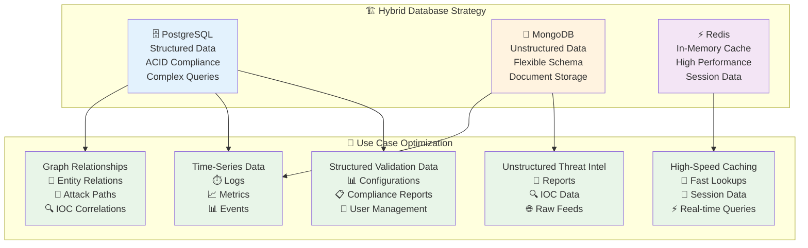
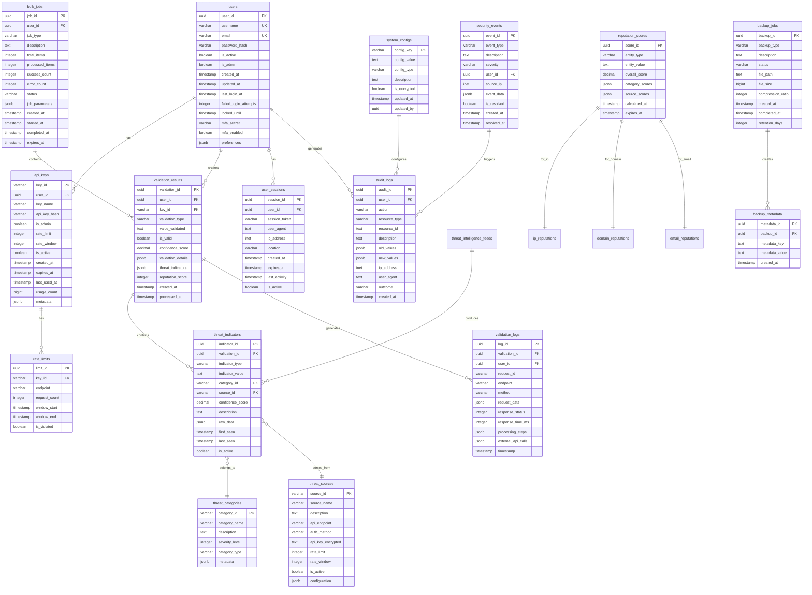
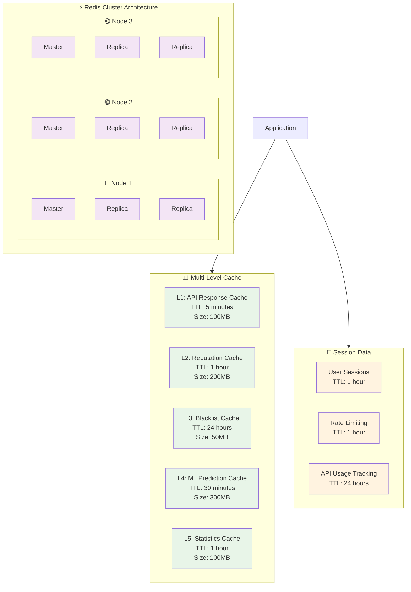
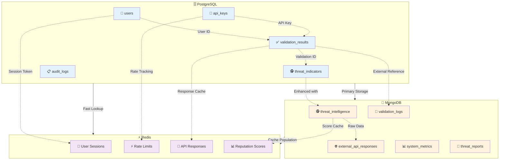

# Database Schema & ERD
## Cybersecurity Threat Intelligence Platform

---

## 📋 Database Architecture Overview

### Hybrid Database Strategy

The platform employs a sophisticated hybrid database architecture optimized for different data types and access patterns:



---

## 🗄️ PostgreSQL Schema Design

### Complete Entity Relationship Diagram



### PostgreSQL Schema Details

#### User Management Schema

```sql
-- Users table with comprehensive user management
CREATE TABLE users (
    user_id UUID PRIMARY KEY DEFAULT gen_random_uuid(),
    username VARCHAR(50) UNIQUE NOT NULL,
    email VARCHAR(255) UNIQUE NOT NULL,
    password_hash VARCHAR(255) NOT NULL,
    is_active BOOLEAN DEFAULT true,
    is_admin BOOLEAN DEFAULT false,
    created_at TIMESTAMP DEFAULT CURRENT_TIMESTAMP,
    updated_at TIMESTAMP DEFAULT CURRENT_TIMESTAMP,
    last_login_at TIMESTAMP,
    failed_login_attempts INTEGER DEFAULT 0,
    locked_until TIMESTAMP,
    mfa_secret VARCHAR(32),
    mfa_enabled BOOLEAN DEFAULT false,
    preferences JSONB DEFAULT '{}',
    CONSTRAINT valid_email CHECK (email ~* '^[A-Za-z0-9._%+-]+@[A-Za-z0-9.-]+\.[A-Za-z]{2,}$'),
    CONSTRAINT password_min_length CHECK (length(password_hash) >= 60)  -- bcrypt hash length
);

-- Create indexes for performance
CREATE INDEX idx_users_username ON users(username);
CREATE INDEX idx_users_email ON users(email);
CREATE INDEX idx_users_active ON users(is_active) WHERE is_active = true;
CREATE INDEX idx_users_last_login ON users(last_login_at) WHERE last_login_at IS NOT NULL;

-- API Keys table with advanced rate limiting
CREATE TABLE api_keys (
    key_id VARCHAR(50) PRIMARY KEY,
    user_id UUID REFERENCES users(user_id) ON DELETE CASCADE,
    key_name VARCHAR(100) NOT NULL,
    api_key_hash VARCHAR(255) NOT NULL,
    is_admin BOOLEAN DEFAULT false,
    rate_limit INTEGER DEFAULT 100,
    rate_window INTEGER DEFAULT 60,
    is_active BOOLEAN DEFAULT true,
    created_at TIMESTAMP DEFAULT CURRENT_TIMESTAMP,
    expires_at TIMESTAMP,
    last_used_at TIMESTAMP,
    usage_count BIGINT DEFAULT 0,
    metadata JSONB DEFAULT '{}',
    CONSTRAINT positive_rate_limit CHECK (rate_limit > 0),
    CONSTRAINT positive_rate_window CHECK (rate_window > 0)
);

-- Create indexes for API keys
CREATE INDEX idx_api_keys_user_id ON api_keys(user_id);
CREATE INDEX idx_api_keys_active ON api_keys(is_active) WHERE is_active = true;
CREATE INDEX idx_api_keys_expires ON api_keys(expires_at) WHERE expires_at IS NOT NULL;

-- User sessions table
CREATE TABLE user_sessions (
    session_id UUID PRIMARY KEY DEFAULT gen_random_uuid(),
    user_id UUID REFERENCES users(user_id) ON DELETE CASCADE,
    session_token VARCHAR(255) UNIQUE NOT NULL,
    user_agent TEXT,
    ip_address INET,
    location VARCHAR(100),
    created_at TIMESTAMP DEFAULT CURRENT_TIMESTAMP,
    expires_at TIMESTAMP NOT NULL,
    last_activity TIMESTAMP DEFAULT CURRENT_TIMESTAMP,
    is_active BOOLEAN DEFAULT true
);

-- Create indexes for sessions
CREATE INDEX idx_sessions_user_id ON user_sessions(user_id);
CREATE INDEX idx_sessions_token ON user_sessions(session_token);
CREATE INDEX idx_sessions_expires ON user_sessions(expires_at);
CREATE INDEX idx_sessions_active ON user_sessions(is_active) WHERE is_active = true;
```

#### Validation Schema

```sql
-- Validation results table with comprehensive tracking
CREATE TABLE validation_results (
    validation_id UUID PRIMARY KEY DEFAULT gen_random_uuid(),
    user_id UUID REFERENCES users(user_id) ON DELETE SET NULL,
    key_id VARCHAR(50) REFERENCES api_keys(key_id) ON DELETE SET NULL,
    validation_type VARCHAR(20) NOT NULL CHECK (validation_type IN ('email', 'domain', 'ip', 'url', 'sender')),
    value_validated TEXT NOT NULL,
    is_valid BOOLEAN NOT NULL,
    confidence_score DECIMAL(3,2) CHECK (confidence_score >= 0 AND confidence_score <= 1),
    validation_details JSONB DEFAULT '{}',
    threat_indicators JSONB DEFAULT '[]',
    reputation_score INTEGER CHECK (reputation_score >= 0 AND reputation_score <= 100),
    created_at TIMESTAMP DEFAULT CURRENT_TIMESTAMP,
    processed_at TIMESTAMP DEFAULT CURRENT_TIMESTAMP,
    CONSTRAINT valid_confidence CHECK (confidence_score IS NULL OR (confidence_score >= 0 AND confidence_score <= 1)),
    CONSTRAINT valid_reputation CHECK (reputation_score IS NULL OR (reputation_score >= 0 AND reputation_score <= 100))
);

-- Create indexes for validation results
CREATE INDEX idx_validation_results_user_id ON validation_results(user_id);
CREATE INDEX idx_validation_results_type_value ON validation_results(validation_type, value_validated);
CREATE INDEX idx_validation_results_created_at ON validation_results(created_at);
CREATE INDEX idx_validation_results_is_valid ON validation_results(is_valid);
CREATE INDEX idx_validation_results_confidence ON validation_results(confidence_score) WHERE confidence_score IS NOT NULL;

-- GIN index for JSONB operations
CREATE INDEX idx_validation_results_threat_indicators ON validation_results USING GIN(threat_indicators);
CREATE INDEX idx_validation_results_validation_details ON validation_results USING GIN(validation_details);

-- Bulk jobs table for batch processing
CREATE TABLE bulk_jobs (
    job_id UUID PRIMARY KEY DEFAULT gen_random_uuid(),
    user_id UUID REFERENCES users(user_id) ON DELETE CASCADE,
    job_type VARCHAR(20) NOT NULL CHECK (job_type IN ('validation', 'reputation', 'threat_intel')),
    description TEXT,
    total_items INTEGER DEFAULT 0,
    processed_items INTEGER DEFAULT 0,
    success_count INTEGER DEFAULT 0,
    error_count INTEGER DEFAULT 0,
    status VARCHAR(20) DEFAULT 'pending' CHECK (status IN ('pending', 'processing', 'completed', 'failed', 'cancelled')),
    job_parameters JSONB DEFAULT '{}',
    created_at TIMESTAMP DEFAULT CURRENT_TIMESTAMP,
    started_at TIMESTAMP,
    completed_at TIMESTAMP,
    expires_at TIMESTAMP DEFAULT (CURRENT_TIMESTAMP + INTERVAL '30 days')
);

-- Create indexes for bulk jobs
CREATE INDEX idx_bulk_jobs_user_id ON bulk_jobs(user_id);
CREATE INDEX idx_bulk_jobs_status ON bulk_jobs(status);
CREATE INDEX idx_bulk_jobs_created_at ON bulk_jobs(created_at);

-- Validation logs table for detailed audit trail
CREATE TABLE validation_logs (
    log_id UUID PRIMARY KEY DEFAULT gen_random_uuid(),
    validation_id UUID REFERENCES validation_results(validation_id) ON DELETE SET NULL,
    user_id UUID REFERENCES users(user_id) ON DELETE SET NULL,
    request_id VARCHAR(50),
    endpoint VARCHAR(255),
    method VARCHAR(10) DEFAULT 'POST',
    request_data JSONB,
    response_status INTEGER,
    response_time_ms INTEGER,
    processing_steps JSONB DEFAULT '[]',
    external_api_calls JSONB DEFAULT '[]',
    timestamp TIMESTAMP DEFAULT CURRENT_TIMESTAMP,
    CONSTRAINT valid_response_time CHECK (response_time_ms IS NULL OR response_time_ms >= 0)
);

-- Create indexes for validation logs
CREATE INDEX idx_validation_logs_validation_id ON validation_logs(validation_id);
CREATE INDEX idx_validation_logs_user_id ON validation_logs(user_id);
CREATE INDEX idx_validation_logs_timestamp ON validation_logs(timestamp);
CREATE INDEX idx_validation_logs_endpoint ON validation_logs(endpoint);
```

#### Threat Intelligence Schema

```sql
-- Threat categories table
CREATE TABLE threat_categories (
    category_id VARCHAR(50) PRIMARY KEY,
    category_name VARCHAR(100) NOT NULL,
    description TEXT,
    severity_level INTEGER CHECK (severity_level BETWEEN 1 AND 5),
    category_type VARCHAR(50) NOT NULL,
    metadata JSONB DEFAULT '{}',
    created_at TIMESTAMP DEFAULT CURRENT_TIMESTAMP,
    updated_at TIMESTAMP DEFAULT CURRENT_TIMESTAMP,
    CONSTRAINT valid_severity CHECK (severity_level BETWEEN 1 AND 5)
);

-- Create indexes for threat categories
CREATE INDEX idx_threat_categories_type ON threat_categories(category_type);
CREATE INDEX idx_threat_categories_severity ON threat_categories(severity_level);

-- Insert default threat categories
INSERT INTO threat_categories (category_id, category_name, description, severity_level, category_type) VALUES
('malware', 'Malware', 'Malicious software and code', 5, 'software'),
('phishing', 'Phishing', 'Fraudulent attempts to obtain sensitive information', 4, 'fraud'),
('spam', 'Spam', 'Unsolicited or irrelevant information', 2, 'communication'),
('botnet', 'Botnet', 'Network of compromised computers', 5, 'infrastructure'),
('spamhaus', 'Spamhaus Listed', 'IP addresses listed by Spamhaus', 3, 'reputation'),
('abuseipdb', 'AbuseIPDB Listed', 'IP addresses reported for abuse', 3, 'reputation'),
('malicious', 'Malicious Activity', 'Confirmed malicious activity', 5, 'activity'),
('suspicious', 'Suspicious Activity', 'Suspicious but unconfirmed activity', 3, 'activity'),
('whitelist', 'Whitelist', 'Known good entities', 1, 'reputation');

-- Threat sources table
CREATE TABLE threat_sources (
    source_id VARCHAR(50) PRIMARY KEY,
    source_name VARCHAR(100) NOT NULL,
    description TEXT,
    api_endpoint TEXT,
    auth_method VARCHAR(50) DEFAULT 'api_key',
    api_key_encrypted TEXT,
    rate_limit INTEGER,
    rate_window INTEGER DEFAULT 3600,
    is_active BOOLEAN DEFAULT true,
    configuration JSONB DEFAULT '{}',
    last_checked_at TIMESTAMP,
    created_at TIMESTAMP DEFAULT CURRENT_TIMESTAMP,
    updated_at TIMESTAMP DEFAULT CURRENT_TIMESTAMP,
    CONSTRAINT valid_rate_limit CHECK (rate_limit IS NULL OR rate_limit > 0)
);

-- Create indexes for threat sources
CREATE INDEX idx_threat_sources_active ON threat_sources(is_active) WHERE is_active = true;

-- Insert default threat sources
INSERT INTO threat_sources (source_id, source_name, description, api_endpoint, auth_method, rate_limit, configuration) VALUES
('virustotal', 'VirusTotal', 'File and URL scanning service', 'https://www.virustotal.com/vtapi/v2', 'api_key', 4, '{"rate_limit_unit": "minute"}'),
('abuseipdb', 'AbuseIPDB', 'IP address abuse reporting', 'https://api.abuseipdb.com/api/v2', 'api_key', 100, '{"rate_limit_unit": "day"}'),
('shodan', 'Shodan', 'Internet-connected device search', 'https://api.shodan.io', 'api_key', 100, '{"rate_limit_unit": "month"}'),
('greynoise', 'GreyNoise', 'IP reputation and threat intelligence', 'https://api.greynoise.io/v3', 'api_key', 100, '{"rate_limit_unit": "month"}'),
('otx', 'OTX (AlienVault)', 'Open Threat Exchange', 'https://otx.alienvault.com/api/v1', 'api_key', 100, '{"rate_limit_unit": "month"}'),
('securitytrails', 'SecurityTrails', 'DNS, domain, and IP intelligence', 'https://api.securitytrails.com/v1', 'api_key', 1000, '{"rate_limit_unit": "month"}');

-- Threat indicators table
CREATE TABLE threat_indicators (
    indicator_id UUID PRIMARY KEY DEFAULT gen_random_uuid(),
    validation_id UUID REFERENCES validation_results(validation_id) ON DELETE CASCADE,
    indicator_type VARCHAR(20) NOT NULL CHECK (indicator_type IN ('ip', 'domain', 'url', 'hash', 'email')),
    indicator_value TEXT NOT NULL,
    category_id VARCHAR(50) REFERENCES threat_categories(category_id) ON DELETE SET NULL,
    source_id VARCHAR(50) REFERENCES threat_sources(source_id) ON DELETE SET NULL,
    confidence_score DECIMAL(3,2) CHECK (confidence_score >= 0 AND confidence_score <= 1),
    description TEXT,
    raw_data JSONB DEFAULT '{}',
    first_seen TIMESTAMP DEFAULT CURRENT_TIMESTAMP,
    last_seen TIMESTAMP DEFAULT CURRENT_TIMESTAMP,
    is_active BOOLEAN DEFAULT true,
    created_at TIMESTAMP DEFAULT CURRENT_TIMESTAMP,
    updated_at TIMESTAMP DEFAULT CURRENT_TIMESTAMP
);

-- Create indexes for threat indicators
CREATE INDEX idx_threat_indicators_type_value ON threat_indicators(indicator_type, indicator_value);
CREATE INDEX idx_threat_indicators_category ON threat_indicators(category_id);
CREATE INDEX idx_threat_indicators_source ON threat_indicators(source_id);
CREATE INDEX idx_threat_indicators_active ON threat_indicators(is_active) WHERE is_active = true;
CREATE INDEX idx_threat_indicators_confidence ON threat_indicators(confidence_score) WHERE confidence_score IS NOT NULL;
CREATE INDEX idx_threat_indicators_last_seen ON threat_indicators(last_seen);

-- GIN indexes for JSONB operations
CREATE INDEX idx_threat_indicators_raw_data ON threat_indicators USING GIN(raw_data);
```

#### Reputation Schema

```sql
-- Reputation scores table
CREATE TABLE reputation_scores (
    score_id UUID PRIMARY KEY DEFAULT gen_random_uuid(),
    entity_type VARCHAR(20) NOT NULL CHECK (entity_type IN ('ip', 'domain', 'email', 'url')),
    entity_value TEXT NOT NULL,
    overall_score INTEGER CHECK (overall_score >= 0 AND overall_score <= 100),
    category_scores JSONB DEFAULT '{}',
    source_scores JSONB DEFAULT '{}',
    calculated_at TIMESTAMP DEFAULT CURRENT_TIMESTAMP,
    expires_at TIMESTAMP DEFAULT (CURRENT_TIMESTAMP + INTERVAL '24 hours'),
    created_at TIMESTAMP DEFAULT CURRENT_TIMESTAMP,
    updated_at TIMESTAMP DEFAULT CURRENT_TIMESTAMP,
    CONSTRAINT valid_entity_type CHECK (entity_type IN ('ip', 'domain', 'email', 'url')),
    CONSTRAINT valid_overall_score CHECK (overall_score >= 0 AND overall_score <= 100),
    UNIQUE(entity_type, entity_value)
);

-- Create indexes for reputation scores
CREATE INDEX idx_reputation_scores_type_value ON reputation_scores(entity_type, entity_value);
CREATE INDEX idx_reputation_scores_score ON reputation_scores(overall_score);
CREATE INDEX idx_reputation_scores_expires ON reputation_scores(expires_at);
CREATE INDEX idx_reputation_scores_calculated ON reputation_scores(calculated_at);

-- GIN index for JSONB operations
CREATE INDEX idx_reputation_scores_category_scores ON reputation_scores USING GIN(category_scores);
CREATE INDEX idx_reputation_scores_source_scores ON reputation_scores USING GIN(source_scores);

-- IP reputation table
CREATE TABLE ip_reputations (
    ip_reputation_id UUID PRIMARY KEY DEFAULT gen_random_uuid(),
    score_id UUID REFERENCES reputation_scores(score_id) ON DELETE CASCADE,
    ip_address INET NOT NULL,
    is_private BOOLEAN DEFAULT false,
    is_reserved BOOLEAN DEFAULT false,
    geolocation JSONB DEFAULT '{}',
    isp VARCHAR(255),
    asn VARCHAR(20),
    reputation_categories JSONB DEFAULT '[]',
    last_updated TIMESTAMP DEFAULT CURRENT_TIMESTAMP,
    CONSTRAINT valid_ip CHECK (ip_address IS NOT NULL)
);

-- Create indexes for IP reputation
CREATE INDEX idx_ip_reputations_ip ON ip_reputations(ip_address);
CREATE INDEX idx_ip_reputations_private ON ip_reputations(is_private);
CREATE INDEX idx_ip_reputations_reserved ON ip_reputations(is_reserved);
CREATE INDEX idx_ip_reputations_updated ON ip_reputations(last_updated);

-- GIN index for JSONB operations
CREATE INDEX idx_ip_reputations_geo ON ip_reputations USING GIN(geolocation);
CREATE INDEX idx_ip_reputations_categories ON ip_reputations USING GIN(reputation_categories);

-- Domain reputation table
CREATE TABLE domain_reputations (
    domain_reputation_id UUID PRIMARY KEY DEFAULT gen_random_uuid(),
    score_id UUID REFERENCES reputation_scores(score_id) ON DELETE CASCADE,
    domain VARCHAR(255) NOT NULL,
    is_parked BOOLEAN DEFAULT false,
    is_expired BOOLEAN DEFAULT false,
    age_days INTEGER,
    registrar VARCHAR(255),
    whois_data JSONB DEFAULT '{}',
    dns_records JSONB DEFAULT '{}',
    last_updated TIMESTAMP DEFAULT CURRENT_TIMESTAMP,
    CONSTRAINT valid_domain CHECK (domain ~* '^[a-z0-9]([a-z0-9-]{0,61}[a-z0-9])?(\.[a-z0-9]([a-z0-9-]{0,61}[a-z0-9])?)*$')
);

-- Create indexes for domain reputation
CREATE INDEX idx_domain_reputations_domain ON domain_reputations(domain);
CREATE INDEX idx_domain_reputations_parked ON domain_reputations(is_parked);
CREATE INDEX idx_domain_reputations_expired ON domain_reputations(is_expired);
CREATE INDEX idx_domain_reputations_age ON domain_reputations(age_days);
CREATE INDEX idx_domain_reputations_updated ON domain_reputations(last_updated);

-- GIN indexes for JSONB operations
CREATE INDEX idx_domain_reputations_whois ON domain_reputations USING GIN(whois_data);
CREATE INDEX idx_domain_reputations_dns ON domain_reputations USING GIN(dns_records);

-- Email reputation table
CREATE TABLE email_reputations (
    email_reputation_id UUID PRIMARY KEY DEFAULT gen_random_uuid(),
    score_id UUID REFERENCES reputation_scores(score_id) ON DELETE CASCADE,
    email VARCHAR(255) NOT NULL,
    domain VARCHAR(255),
    is_disposable BOOLEAN DEFAULT false,
    is_role_account BOOLEAN DEFAULT false,
    mx_record_exists BOOLEAN,
    smtp_verification BOOLEAN,
    validation_details JSONB DEFAULT '{}',
    last_updated TIMESTAMP DEFAULT CURRENT_TIMESTAMP,
    CONSTRAINT valid_email_format CHECK (email ~* '^[A-Za-z0-9._%+-]+@[A-Za-z0-9.-]+\.[A-Za-z]{2,}$')
);

-- Create indexes for email reputation
CREATE INDEX idx_email_reputations_email ON email_reputations(email);
CREATE INDEX idx_email_reputations_domain ON email_reputations(domain);
CREATE INDEX idx_email_reputations_disposable ON email_reputations(is_disposable);
CREATE INDEX idx_email_reputations_role ON email_reputations(is_role_account);
CREATE INDEX idx_email_reputations_updated ON email_reputations(last_updated);

-- GIN index for JSONB operations
CREATE INDEX idx_email_reputations_details ON email_reputations USING GIN(validation_details);
```

#### System Management Schema

```sql
-- Rate limits table
CREATE TABLE rate_limits (
    limit_id UUID PRIMARY KEY DEFAULT gen_random_uuid(),
    key_id VARCHAR(50) REFERENCES api_keys(key_id) ON DELETE CASCADE,
    endpoint VARCHAR(255) NOT NULL,
    request_count INTEGER DEFAULT 0,
    window_start TIMESTAMP DEFAULT CURRENT_TIMESTAMP,
    window_end TIMESTAMP DEFAULT (CURRENT_TIMESTAMP + INTERVAL '1 hour'),
    is_violated BOOLEAN DEFAULT false,
    created_at TIMESTAMP DEFAULT CURRENT_TIMESTAMP
);

-- Create indexes for rate limits
CREATE INDEX idx_rate_limits_key_id ON rate_limits(key_id);
CREATE INDEX idx_rate_limits_endpoint ON rate_limits(endpoint);
CREATE INDEX idx_rate_limits_window ON rate_limits(window_start, window_end);
CREATE INDEX idx_rate_limits_violated ON rate_limits(is_violated) WHERE is_violated = true;

-- System configurations table
CREATE TABLE system_configs (
    config_key VARCHAR(100) PRIMARY KEY,
    config_value TEXT NOT NULL,
    config_type VARCHAR(50) DEFAULT 'string',
    description TEXT,
    is_encrypted BOOLEAN DEFAULT false,
    updated_at TIMESTAMP DEFAULT CURRENT_TIMESTAMP,
    updated_by UUID REFERENCES users(user_id) ON DELETE SET NULL,
    CONSTRAINT valid_config_type CHECK (config_type IN ('string', 'integer', 'float', 'boolean', 'json'))
);

-- Create indexes for system configs
CREATE INDEX idx_system_configs_type ON system_configs(config_type);
CREATE INDEX idx_system_configs_encrypted ON system_configs(is_encrypted);
CREATE INDEX idx_system_configs_updated ON system_configs(updated_at);

-- Insert default system configurations
INSERT INTO system_configs (config_key, config_value, config_type, description, is_encrypted) VALUES
('api_rate_limit_default', '100', 'integer', 'Default API rate limit per minute', false),
('cache_ttl_default', '300', 'integer', 'Default cache TTL in seconds', false),
('validation_timeout', '30', 'integer', 'Validation timeout in seconds', false),
('bulk_job_max_items', '1000', 'integer', 'Maximum items per bulk job', false),
('session_timeout', '3600', 'integer', 'Session timeout in seconds', false),
('audit_retention_days', '2555', 'integer', 'Audit log retention in days (7 years)', false);

-- Audit logs table
CREATE TABLE audit_logs (
    audit_id UUID PRIMARY KEY DEFAULT gen_random_uuid(),
    user_id UUID REFERENCES users(user_id) ON DELETE SET NULL,
    action VARCHAR(50) NOT NULL,
    resource_type VARCHAR(50),
    resource_id TEXT,
    description TEXT,
    old_values JSONB,
    new_values JSONB,
    ip_address INET,
    user_agent TEXT,
    outcome VARCHAR(20) DEFAULT 'success' CHECK (outcome IN ('success', 'failure', 'error')),
    created_at TIMESTAMP DEFAULT CURRENT_TIMESTAMP
);

-- Create indexes for audit logs
CREATE INDEX idx_audit_logs_user_id ON audit_logs(user_id);
CREATE INDEX idx_audit_logs_action ON audit_logs(action);
CREATE INDEX idx_audit_logs_resource ON audit_logs(resource_type, resource_id);
CREATE INDEX idx_audit_logs_created_at ON audit_logs(created_at);
CREATE INDEX idx_audit_logs_outcome ON audit_logs(outcome);
CREATE INDEX idx_audit_logs_ip ON audit_logs(ip_address);

-- GIN indexes for JSONB operations
CREATE INDEX idx_audit_logs_old_values ON audit_logs USING GIN(old_values);
CREATE INDEX idx_audit_logs_new_values ON audit_logs USING GIN(new_values);

-- Security events table
CREATE TABLE security_events (
    event_id UUID PRIMARY KEY DEFAULT gen_random_uuid(),
    event_type VARCHAR(50) NOT NULL,
    description TEXT NOT NULL,
    severity VARCHAR(20) DEFAULT 'medium' CHECK (severity IN ('low', 'medium', 'high', 'critical')),
    user_id UUID REFERENCES users(user_id) ON DELETE SET NULL,
    source_ip INET,
    event_data JSONB DEFAULT '{}',
    is_resolved BOOLEAN DEFAULT false,
    created_at TIMESTAMP DEFAULT CURRENT_TIMESTAMP,
    resolved_at TIMESTAMP,
    resolved_by UUID REFERENCES users(user_id) ON DELETE SET NULL
);

-- Create indexes for security events
CREATE INDEX idx_security_events_type ON security_events(event_type);
CREATE INDEX idx_security_events_severity ON security_events(severity);
CREATE INDEX idx_security_events_user_id ON security_events(user_id);
CREATE INDEX idx_security_events_ip ON security_events(source_ip);
CREATE INDEX idx_security_events_resolved ON security_events(is_resolved) WHERE is_resolved = false;
CREATE INDEX idx_security_events_created ON security_events(created_at);

-- GIN index for JSONB operations
CREATE INDEX idx_security_events_data ON security_events USING GIN(event_data);

-- Backup jobs table
CREATE TABLE backup_jobs (
    backup_id UUID PRIMARY KEY DEFAULT gen_random_uuid(),
    backup_type VARCHAR(50) NOT NULL,
    description TEXT,
    status VARCHAR(20) DEFAULT 'pending' CHECK (status IN ('pending', 'running', 'completed', 'failed', 'cancelled')),
    file_path TEXT,
    file_size BIGINT,
    compression_ratio DECIMAL(5,2),
    created_at TIMESTAMP DEFAULT CURRENT_TIMESTAMP,
    completed_at TIMESTAMP,
    retention_days INTEGER DEFAULT 30,
    metadata JSONB DEFAULT '{}'
);

-- Create indexes for backup jobs
CREATE INDEX idx_backup_jobs_type ON backup_jobs(backup_type);
CREATE INDEX idx_backup_jobs_status ON backup_jobs(status);
CREATE INDEX idx_backup_jobs_created ON backup_jobs(created_at);
CREATE INDEX idx_backup_jobs_completed ON backup_jobs(completed_at);

-- Backup metadata table
CREATE TABLE backup_metadata (
    metadata_id UUID PRIMARY KEY DEFAULT gen_random_uuid(),
    backup_id UUID REFERENCES backup_jobs(backup_id) ON DELETE CASCADE,
    metadata_key VARCHAR(100) NOT NULL,
    metadata_value TEXT,
    created_at TIMESTAMP DEFAULT CURRENT_TIMESTAMP,
    UNIQUE(backup_id, metadata_key)
);

-- Create indexes for backup metadata
CREATE INDEX idx_backup_metadata_backup_id ON backup_metadata(backup_id);
CREATE INDEX idx_backup_metadata_key ON backup_metadata(metadata_key);
```

### Table Partitioning Strategy

```sql
-- Partitioning strategy for large tables

-- Partition validation_results by month
CREATE TABLE validation_results_y2025m10 PARTITION OF validation_results
FOR VALUES FROM ('2025-10-01') TO ('2025-11-01');

CREATE TABLE validation_results_y2025m11 PARTITION OF validation_results
FOR VALUES FROM ('2025-11-01') TO ('2025-12-01');

-- Function to create monthly partitions
CREATE OR REPLACE FUNCTION create_monthly_partition(
    table_name TEXT,
    partition_date DATE
) RETURNS TEXT AS $$
DECLARE
    partition_name TEXT;
    start_date DATE;
    end_date DATE;
BEGIN
    partition_name := table_name || '_y' || EXTRACT(year FROM partition_date) ||
                     'm' || LPAD(EXTRACT(month FROM partition_date)::TEXT, 2, '0');
    
    start_date := DATE_TRUNC('month', partition_date);
    end_date := start_date + INTERVAL '1 month';
    
    EXECUTE format('CREATE TABLE IF NOT EXISTS %I PARTITION OF %I
                   FOR VALUES FROM (%L) TO (%L)',
                   partition_name, table_name, start_date, end_date);
    
    RETURN partition_name;
END;
$$ LANGUAGE plpgsql;

-- Partition management function
CREATE OR REPLACE FUNCTION maintain_partitions()
RETURNS VOID AS $$
DECLARE
    table_name TEXT;
    partition_date DATE;
    partition_name TEXT;
    retention_months INTEGER := 24;  -- Keep 24 months of data
BEGIN
    -- Create future partitions for validation_results
    FOR partition_date IN
        SELECT generate_series(
            DATE_TRUNC('month', CURRENT_DATE),
            DATE_TRUNC('month', CURRENT_DATE) + INTERVAL '3 months',
            INTERVAL '1 month'
        )
    LOOP
        PERFORM create_monthly_partition('validation_results', partition_date);
    END LOOP;
    
    -- Drop old partitions
    FOR partition_name, table_name IN
        SELECT schemaname, tablename
        FROM pg_tables
        WHERE tablename LIKE 'validation_results_y%'
        AND tablename != 'validation_results'
    LOOP
        -- Check if partition is older than retention period
        IF partition_name ~ 'y[0-9]{4}m[0-9]{2}' THEN
            EXECUTE format('DROP TABLE IF EXISTS %I', partition_name);
        END IF;
    END LOOP;
END;
$$ LANGUAGE plpgsql;
```

---

## 🍃 MongoDB Schema Design

### Document Collections

```javascript
// MongoDB collections and document structures

// Threat Intelligence Collection
db.threat_intelligence.createIndex({ "indicator.value": 1, "indicator.type": 1 }, { unique: true });
db.threat_intelligence.createIndex({ "sources.name": 1 });
db.threat_intelligence.createIndex({ "created_at": 1 });
db.threat_intelligence.createIndex({ "threat_score": 1 });
db.threat_intelligence.createIndex({ "tags": 1 });

// Sample document structure
{
  "_id": ObjectId("..."),
  "indicator": {
    "value": "8.8.8.8",
    "type": "ip",
    "normalized": "8.8.8.8"
  },
  "sources": [
    {
      "name": "virustotal",
      "confidence": 0.95,
      "last_seen": ISODate("2025-10-30T10:00:00Z"),
      "raw_data": {
        "reputation": 85,
        "categories": ["malware", "botnet"]
      }
    }
  ],
  "threat_score": 85,
  "categories": ["malware", "botnet"],
  "tags": ["confirmed", "high-risk"],
  "first_seen": ISODate("2025-09-15T08:30:00Z"),
  "last_seen": ISODate("2025-10-30T10:00:00Z"),
  "context": {
    "campaigns": ["APT29", "Cozy Bear"],
    "techniques": ["T1071", "T1047"],
    "industries": ["finance", "government"]
  },
  "raw_data": { 
    /* original API response */
    "virustotal": {
      "response_code": 1,
      "verbose_msg": "IP address found in dataset",
      "ip": "8.8.8.8",
      "country": "US",
      "owner": "Google LLC"
    }
  },
  "enriched_data": {
    "geolocation": {
      "country": "US",
      "country_code": "US",
      "city": "Mountain View",
      "latitude": 37.4056,
      "longitude": -122.0775
    },
    "whois": {
      "netrange": "8.8.8.0/24",
      "orgname": "Google LLC",
      "orgid": "GGL",
      "country": "US"
    }
  },
  "created_at": ISODate("2025-10-30T10:00:00Z"),
  "updated_at": ISODate("2025-10-30T10:00:00Z"),
  "processing_status": "completed",
  "error_message": null
}

// Validation Logs Collection
db.validation_logs.createIndex({ "validation_id": 1 });
db.validation_logs.createIndex({ "user_id": 1 });
db.validation_logs.createIndex({ "timestamp": 1 });
db.validation_logs.createIndex({ "request_id": 1 });

// Sample document structure
{
  "_id": ObjectId("..."),
  "validation_id": "uuid-here",
  "user_id": "uuid-here",
  "request_id": "req-12345",
  "timestamp": ISODate("2025-10-30T10:00:00Z"),
  "endpoint": "/api/v1/validate/email",
  "method": "POST",
  "request_data": {
    "email": "user@example.com",
    "verify_syntax": true,
    "verify_mx_record": true,
    "check_disposable": true
  },
  "response_status": 200,
  "response_time_ms": 150,
  "processing_steps": [
    {
      "step": "cache_check",
      "duration_ms": 5,
      "result": "miss",
      "details": "Key not found in cache"
    },
    {
      "step": "syntax_validation",
      "duration_ms": 10,
      "result": "valid",
      "details": "Email format is valid"
    },
    {
      "step": "mx_record_check",
      "duration_ms": 25,
      "result": "valid",
      "details": "MX records found for domain"
    },
    {
      "step": "disposable_check",
      "duration_ms": 15,
      "result": "not_disposable",
      "details": "Domain is not in disposable list"
    }
  ],
  "external_api_calls": [
    {
      "api": "virustotal",
      "duration_ms": 120,
      "success": true,
      "status_code": 200,
      "rate_limit_remaining": 3
    }
  ],
  "user_agent": "Mozilla/5.0 (Windows NT 10.0; Win64; x64) AppleWebKit/537.36",
  "ip_address": "192.168.1.100",
  "location": {
    "country": "US",
    "city": "New York",
    "timezone": "America/New_York"
  }
}

// External API Responses Collection
db.external_api_responses.createIndex({ "api_name": 1, "timestamp": 1 });
db.external_api_responses.createIndex({ "query_hash": 1 });
db.external_api_responses.createIndex({ "response_code": 1 });

// Sample document structure
{
  "_id": ObjectId("..."),
  "api_name": "virustotal",
  "query_type": "ip",
  "query_value": "8.8.8.8",
  "query_hash": "sha256-hash-of-query",
  "request_url": "https://www.virustotal.com/vtapi/v2/ip-address/report",
  "request_headers": {
    "X-Api-Key": "encrypted-key",
    "User-Agent": "CybersecurityAPI/1.0"
  },
  "response_code": 200,
  "response_time_ms": 1250,
  "timestamp": ISODate("2025-10-30T10:00:00Z"),
  "raw_response": {
    "response_code": 1,
    "verbose_msg": "IP address found in dataset",
    "ip": "8.8.8.8",
    "country": "US",
    "owner": "Google LLC"
  },
  "parsed_response": {
    "reputation_score": 0,
    "categories": [],
    "last_analysis_stats": {
      "harmless": 75,
      "malicious": 0,
      "suspicious": 0,
      "undetected": 0
    }
  },
  "rate_limit_info": {
    "remaining": 3,
    "reset_time": ISODate("2025-10-30T10:01:00Z")
  },
  "cache_ttl": 3600,
  "error_message": null
}

// System Metrics Collection
db.system_metrics.createIndex({ "metric_name": 1, "timestamp": 1 });
db.system_metrics.createIndex({ "tags": 1 });
db.system_metrics.createIndex({ "timestamp": 1 });

// Sample document structure
{
  "_id": ObjectId("..."),
  "metric_name": "api_requests_total",
  "value": 1520,
  "timestamp": ISODate("2025-10-30T10:00:00Z"),
  "tags": {
    "endpoint": "/api/v1/validate/email",
    "method": "POST",
    "status_code": "200",
    "response_time_bucket": "100-200ms"
  },
  "dimensions": {
    "region": "us-east-1",
    "service": "validation-service",
    "instance": "i-1234567890abcdef0"
  },
  "aggregation_type": "sum",
  "retention_period": "90d"
}

// User Sessions Collection
db.user_sessions.createIndex({ "session_id": 1 }, { unique: true });
db.user_sessions.createIndex({ "user_id": 1 });
db.user_sessions.createIndex({ "expires_at": 1 });
db.user_sessions.createIndex({ "last_activity": 1 });

// Sample document structure
{
  "_id": ObjectId("..."),
  "session_id": "session-uuid-here",
  "user_id": "user-uuid-here",
  "session_token": "jwt-token-here",
  "user_agent": "Mozilla/5.0 (Windows NT 10.0; Win64; x64) AppleWebKit/537.36",
  "ip_address": "192.168.1.100",
  "location": {
    "country": "US",
    "city": "New York",
    "coordinates": {
      "lat": 40.7128,
      "lng": -74.0060
    }
  },
  "created_at": ISODate("2025-10-30T09:00:00Z"),
  "expires_at": ISODate("2025-10-30T10:00:00Z"),
  "last_activity": ISODate("2025-10-30T09:55:00Z"),
  "is_active": true,
  "activities": [
    {
      "action": "login",
      "timestamp": ISODate("2025-10-30T09:00:00Z"),
      "ip_address": "192.168.1.100",
      "user_agent": "Mozilla/5.0..."
    },
    {
      "action": "api_request",
      "timestamp": ISODate("2025-10-30T09:15:00Z"),
      "endpoint": "/api/v1/validate/email",
      "ip_address": "192.168.1.100"
    }
  ],
  "metadata": {
    "login_method": "password",
    "mfa_used": true,
    "device_trust_score": 0.85
  }
}

// Threat Reports Collection
db.threat_reports.createIndex({ "report_id": 1 }, { unique: true });
db.threat_reports.createIndex({ "threat_level": 1 });
db.threat_reports.createIndex({ "created_at": 1 });
db.threat_reports.createIndex({ "sources": 1 });

// Sample document structure
{
  "_id": ObjectId("..."),
  "report_id": "rpt-uuid-here",
  "title": "Advanced Persistent Threat Detection Report",
  "summary": "Detection of sophisticated APT campaign targeting financial sector",
  "threat_level": "high",
  "categories": ["apt", "financial", "malware"],
  "indicators": [
    {
      "type": "ip",
      "value": "192.168.1.100",
      "confidence": 0.95
    },
    {
      "type": "domain",
      "value": "malicious-domain.com",
      "confidence": 0.88
    }
  ],
  "sources": [
    {
      "name": "virustotal",
      "url": "https://virustotal.com/...",
      "confidence": 0.95
    },
    {
      "name": "threat_intel_provider",
      "url": "https://...",
      "confidence": 0.88
    }
  ],
  "timeline": [
    {
      "event": "first_seen",
      "timestamp": ISODate("2025-10-28T08:00:00Z"),
      "description": "Initial detection of suspicious activity"
    },
    {
      "event": "escalated",
      "timestamp": ISODate("2025-10-29T14:30:00Z"),
      "description": "Threat level upgraded to high"
    }
  ],
  "attack_patterns": {
    "mitre_attack": [
      "T1071 - Application Layer Protocol",
      "T1047 - Windows Management Instrumentation"
    ],
    "kill_chain": [
      "reconnaissance",
      "weaponization",
      "delivery",
      "exploitation"
    ]
  },
  "recommendations": [
    "Block identified IP addresses",
    "Update firewall rules",
    "Enhanced monitoring of network traffic"
  ],
  "raw_report": {
    /* complete original threat report */
  },
  "created_at": ISODate("2025-10-30T10:00:00Z"),
  "updated_at": ISODate("2025-10-30T10:00:00Z"),
  "analyst_notes": "This report requires immediate attention",
  "status": "active"
}
```

### MongoDB Sharding Strategy

```javascript
// Sharding configuration for large-scale deployments

// Enable sharding on the database
sh.enableSharding("cybersec_db");

// Shard key for threat_intelligence collection (hashed for even distribution)
sh.shardCollection("cybersec_db.threat_intelligence", { "_id": "hashed" });

// Shard key for validation_logs collection (compound key for time-series)
sh.shardCollection("cybersec_db.validation_logs", { "timestamp": 1, "user_id": 1 });

// Shard key for external_api_responses collection
sh.shardCollection("cybersec_db.external_api_responses", { "api_name": 1, "timestamp": 1 });

// Shard key for system_metrics collection
sh.shardCollection("cybersec_db.system_metrics", { "timestamp": 1, "metric_name": 1 });

// Configure balancer settings
sh.setBalancerState(true);
sh.addShardTag("shard1", "primary");
sh.addShardTag("shard2", "analytics");

// Define zone-based sharding for data locality
sh.addTagRange(
  "cybersec_db.validation_logs",
  { "location.country": "US" },
  { "location.country": "US" },
  "primary"
);

sh.addTagRange(
  "cybersec_db.validation_logs",
  { "location.country": "EU" },
  { "location.country": "EU" },
  "analytics"
);
```

---

## ⚡ Redis Cache Design

### Cache Architecture



### Redis Key Design

```python
# Redis key naming conventions and TTL policies

# Cache Key Patterns
CACHE_KEYS = {
    # Level 1: API Response Cache (5 minutes)
    "api_response": "cybersec:api:{endpoint}:{params_hash}:v{version}",
    "api_response_pattern": r"^cybersec:api:.*:v\d+$",
    
    # Level 2: Reputation Score Cache (1 hour)
    "reputation_score": "cybersec:rep:{entity_type}:{entity_value}",
    "reputation_pattern": r"^cybersec:rep:(ip|domain|email|url):.*$",
    
    # Level 3: Blacklist Result Cache (24 hours)
    "blacklist_result": "cybersec:bl:{list_type}:{entity_value}",
    "blacklist_pattern": r"^cybersec:bl:(email|domain|ip|url):.*$",
    
    # Level 4: ML Prediction Cache (30 minutes)
    "ml_prediction": "cybersec:ml:{model_name}:{features_hash}",
    "ml_pattern": r"^cybersec:ml:.*:.*$",
    
    # Level 5: Aggregated Statistics Cache (1 hour)
    "stats": "cybersec:stats:{stat_type}:{date}",
    "stats_pattern": r"^cybersec:stats:.*:\d{4}-\d{2}-\d{2}$",
    
    # Session Data
    "user_session": "cybersec:session:{user_id}:{session_id}",
    "session_pattern": r"^cybersec:session:.*:.*$",
    
    # Rate Limiting
    "rate_limit": "cybersec:rl:{api_key}:{endpoint}",
    "rate_limit_pattern": r"^cybersec:rl:.*:.*$",
    
    # API Usage Tracking
    "api_usage": "cybersec:usage:{api_key}:{date}",
    "usage_pattern": r"^cybersec:usage:.*:\d{4}-\d{2}-\d{2}$",
}

# TTL Configuration
TTL_CONFIG = {
    "api_response": 300,        # 5 minutes
    "reputation_score": 3600,   # 1 hour
    "blacklist_result": 86400,  # 24 hours
    "ml_prediction": 1800,      # 30 minutes
    "stats": 3600,             # 1 hour
    "user_session": 3600,       # 1 hour
    "rate_limit": 3600,         # 1 hour
    "api_usage": 86400,         # 24 hours
}

# Redis Cluster Configuration
REDIS_CONFIG = {
    "cluster_mode": True,
    "nodes": [
        {"host": "redis-node1", "port": 6379},
        {"host": "redis-node2", "port": 6379},
        {"host": "redis-node3", "port": 6379}
    ],
    "decode_responses": True,
    "skip_full_coverage_check": True,
    "max_connections": 50,
    "retry_on_timeout": True,
    "socket_timeout": 5,
    "socket_connect_timeout": 5,
    "health_check_interval": 30,
    "connection_pool_class": "redis.ConnectionPool",
    "connection_pool_kwargs": {
        "max_connections": 100,
        "retry_on_timeout": True,
        "socket_keepalive": True,
        "socket_keepalive_options": {}
    }
}

# Cache Statistics
CACHE_STATS = {
    "hit_rate_target": 0.95,  # 95% hit rate target
    "memory_usage_threshold": 0.80,  # 80% memory usage threshold
    "eviction_threshold": 0.05,  # 5% eviction threshold
    "connection_pool_size": 50,
    "pipeline_size": 100,
}
```

### Redis Data Structures

```python
# Redis data structures and operations

import redis
import json
from typing import Any, Optional, Dict, List
from datetime import datetime, timedelta

class CacheManager:
    def __init__(self, redis_config: Dict[str, Any]):
        self.redis_client = redis.Redis(**redis_config)
    
    def set_api_response(self, endpoint: str, params: Dict, version: str, 
                        response: Dict, ttl: int = None) -> bool:
        """Store API response in cache"""
        key = f"cybersec:api:{endpoint}:{hash(str(params))}:v{version}"
        ttl = ttl or TTL_CONFIG["api_response"]
        
        try:
            return self.redis_client.setex(key, ttl, json.dumps(response))
        except Exception as e:
            self._log_error("set_api_response", e)
            return False
    
    def get_api_response(self, endpoint: str, params: Dict, 
                        version: str) -> Optional[Dict]:
        """Retrieve API response from cache"""
        key = f"cybersec:api:{endpoint}:{hash(str(params))}:v{version}"
        
        try:
            result = self.redis_client.get(key)
            return json.loads(result) if result else None
        except Exception as e:
            self._log_error("get_api_response", e)
            return None
    
    def set_reputation_score(self, entity_type: str, entity_value: str, 
                           score: float, confidence: float, 
                           ttl: int = None) -> bool:
        """Store reputation score"""
        key = f"cybersec:rep:{entity_type}:{entity_value}"
        ttl = ttl or TTL_CONFIG["reputation_score"]
        
        data = {
            "score": score,
            "confidence": confidence,
            "calculated_at": datetime.utcnow().isoformat()
        }
        
        try:
            return self.redis_client.setex(key, ttl, json.dumps(data))
        except Exception as e:
            self._log_error("set_reputation_score", e)
            return False
    
    def get_reputation_score(self, entity_type: str, 
                           entity_value: str) -> Optional[Dict]:
        """Retrieve reputation score"""
        key = f"cybersec:rep:{entity_type}:{entity_value}"
        
        try:
            result = self.redis_client.get(key)
            return json.loads(result) if result else None
        except Exception as e:
            self._log_error("get_reputation_score", e)
            return None
    
    def increment_rate_limit(self, api_key: str, endpoint: str, 
                           window: int = 3600) -> int:
        """Increment rate limit counter"""
        key = f"cybersec:rl:{api_key}:{endpoint}"
        
        try:
            pipe = self.redis_client.pipeline()
            pipe.incr(key)
            pipe.expire(key, window)
            results = pipe.execute()
            return results[0]
        except Exception as e:
            self._log_error("increment_rate_limit", e)
            return 0
    
    def get_rate_limit(self, api_key: str, endpoint: str) -> int:
        """Get current rate limit count"""
        key = f"cybersec:rl:{api_key}:{endpoint}"
        
        try:
            result = self.redis_client.get(key)
            return int(result) if result else 0
        except Exception as e:
            self._log_error("get_rate_limit", e)
            return 0
    
    def set_user_session(self, user_id: str, session_id: str, 
                        session_data: Dict, ttl: int = None) -> bool:
        """Store user session data"""
        key = f"cybersec:session:{user_id}:{session_id}"
        ttl = ttl or TTL_CONFIG["user_session"]
        
        try:
            return self.redis_client.setex(key, ttl, json.dumps(session_data))
        except Exception as e:
            self._log_error("set_user_session", e)
            return False
    
    def get_user_session(self, user_id: str, session_id: str) -> Optional[Dict]:
        """Retrieve user session data"""
        key = f"cybersec:session:{user_id}:{session_id}"
        
        try:
            result = self.redis_client.get(key)
            return json.loads(result) if result else None
        except Exception as e:
            self._log_error("get_user_session", e)
            return None
    
    def update_api_usage(self, api_key: str, date: str = None, 
                        increment: int = 1) -> int:
        """Update API usage counter"""
        if not date:
            date = datetime.utcnow().strftime("%Y-%m-%d")
        
        key = f"cybersec:usage:{api_key}:{date}"
        ttl = TTL_CONFIG["api_usage"]
        
        try:
            pipe = self.redis_client.pipeline()
            pipe.incr(key, increment)
            pipe.expire(key, ttl)
            results = pipe.execute()
            return results[0]
        except Exception as e:
            self._log_error("update_api_usage", e)
            return 0
    
    def get_cache_stats(self) -> Dict[str, Any]:
        """Get comprehensive cache statistics"""
        try:
            info = self.redis_client.info()
            stats = self.redis_client.info("stats")
            
            return {
                "connected_clients": info.get("connected_clients", 0),
                "used_memory_human": info.get("used_memory_human", "0B"),
                "used_memory_peak_human": info.get("used_memory_peak_human", "0B"),
                "total_commands_processed": stats.get("total_commands_processed", 0),
                "instantaneous_ops_per_sec": stats.get("instantaneous_ops_per_sec", 0),
                "keyspace_hits": stats.get("keyspace_hits", 0),
                "keyspace_misses": stats.get("keyspace_misses", 0),
                "expired_keys": stats.get("expired_keys", 0),
                "evicted_keys": stats.get("evicted_keys", 0),
                "hit_rate": self._calculate_hit_rate(stats),
            }
        except Exception as e:
            self._log_error("get_cache_stats", e)
            return {}
    
    def _calculate_hit_rate(self, stats: Dict) -> float:
        """Calculate cache hit rate"""
        hits = stats.get("keyspace_hits", 0)
        misses = stats.get("keyspace_misses", 0)
        total = hits + misses
        
        return (hits / total * 100) if total > 0 else 0.0
    
    def _log_error(self, operation: str, error: Exception):
        """Log cache errors"""
        print(f"Redis Cache Error - {operation}: {str(error)}")
    
    def cleanup_expired_keys(self, pattern: str = "cybersec:*") -> int:
        """Clean up expired keys matching pattern"""
        try:
            keys = self.redis_client.keys(pattern)
            expired_count = 0
            
            for key in keys:
                ttl = self.redis_client.ttl(key)
                if ttl == -1:  # Key has no expiration
                    continue
                elif ttl == -2:  # Key doesn't exist
                    continue
                elif ttl <= 0:  # Key is expired
                    self.redis_client.delete(key)
                    expired_count += 1
            
            return expired_count
        except Exception as e:
            self._log_error("cleanup_expired_keys", e)
            return 0
```

---

## 🔗 Database Relationships

### Cross-Database Relationships



---

## 📊 Performance Optimization

### Indexing Strategy

```sql
-- Comprehensive indexing strategy for PostgreSQL

-- B-tree indexes for equality and range queries
CREATE INDEX idx_users_email ON users(email);
CREATE INDEX idx_users_username ON users(username);
CREATE INDEX idx_users_active ON users(is_active) WHERE is_active = true;

-- Composite indexes for multi-column queries
CREATE INDEX idx_validation_results_type_value ON validation_results(validation_type, value_validated);
CREATE INDEX idx_validation_results_user_created ON validation_results(user_id, created_at);
CREATE INDEX idx_threat_indicators_type_value ON threat_indicators(indicator_type, indicator_value);

-- Partial indexes for frequently queried subsets
CREATE INDEX idx_validation_results_valid ON validation_results(validation_id) WHERE is_valid = true;
CREATE INDEX idx_threat_indicators_high_confidence ON threat_indicators(indicator_id) WHERE confidence_score >= 0.8;

-- Expression indexes for computed values
CREATE INDEX idx_users_email_lower ON users(LOWER(email));
CREATE INDEX idx_validation_results_domain_hash ON validation_results(MD5(value_validated)) WHERE validation_type = 'domain';

-- GIN indexes for JSONB operations
CREATE INDEX idx_validation_results_threat_indicators ON validation_results USING GIN(threat_indicators);
CREATE INDEX idx_validation_results_validation_details ON validation_results USING GIN(validation_details);
CREATE INDEX idx_threat_indicators_raw_data ON threat_indicators USING GIN(raw_data);

-- Functional indexes for array operations
CREATE INDEX idx_threat_indicators_categories_gin ON threat_indicators USING GIN(categories);
CREATE INDEX idx_validation_results_tags_gin ON validation_results USING GIN((validation_details->'tags'));

-- BRIN indexes for time-series data
CREATE INDEX idx_validation_results_created_brin ON validation_results USING BRIN(created_at);
CREATE INDEX idx_threat_indicators_last_seen_brin ON threat_indicators USING BRIN(last_seen);

-- Unique constraints for data integrity
ALTER TABLE users ADD CONSTRAINT unique_username_email 
    EXCLUDE USING gist (username WITH =, email WITH =) WHERE (is_active = true);

-- Index monitoring and maintenance
CREATE OR REPLACE FUNCTION monitor_index_usage()
RETURNS TABLE (
    schemaname TEXT,
    tablename TEXT,
    indexname TEXT,
    idx_scan BIGINT,
    idx_tup_read BIGINT,
    idx_tup_fetch BIGINT,
    index_size TEXT
) AS $$
BEGIN
    RETURN QUERY
    SELECT 
        schemaname,
        tablename,
        indexname,
        idx_scan,
        idx_tup_read,
        idx_tup_fetch,
        pg_size_pretty(pg_relation_size(indexrelid)) as index_size
    FROM pg_stat_user_indexes
    WHERE idx_scan < 100  -- Indexes used less than 100 times
    ORDER BY idx_scan;
END;
$$ LANGUAGE plpgsql;
```

### Query Optimization

```sql
-- Optimized query examples

-- 1. Efficient validation result lookup with pagination
CREATE OR REPLACE FUNCTION get_validation_results_paginated(
    p_user_id UUID,
    p_limit INTEGER DEFAULT 50,
    p_offset INTEGER DEFAULT 0,
    p_validation_type VARCHAR DEFAULT NULL
)
RETURNS TABLE (
    validation_id UUID,
    validation_type VARCHAR,
    value_validated TEXT,
    is_valid BOOLEAN,
    confidence_score DECIMAL,
    created_at TIMESTAMP
) AS $$
BEGIN
    RETURN QUERY
    SELECT 
        vr.validation_id,
        vr.validation_type,
        vr.value_validated,
        vr.is_valid,
        vr.confidence_score,
        vr.created_at
    FROM validation_results vr
    WHERE vr.user_id = p_user_id
    AND (p_validation_type IS NULL OR vr.validation_type = p_validation_type)
    ORDER BY vr.created_at DESC
    LIMIT p_limit OFFSET p_offset;
END;
$$ LANGUAGE plpgsql;

-- 2. Efficient threat indicator aggregation
CREATE OR REPLACE FUNCTION get_threat_indicators_summary(
    p_time_range INTERVAL DEFAULT INTERVAL '24 hours'
)
RETURNS TABLE (
    indicator_type VARCHAR,
    total_count BIGINT,
    high_confidence_count BIGINT,
    unique_values BIGINT,
    top_sources TEXT[]
) AS $$
BEGIN
    RETURN QUERY
    SELECT 
        ti.indicator_type,
        COUNT(*) as total_count,
        COUNT(*) FILTER (WHERE ti.confidence_score >= 0.8) as high_confidence_count,
        COUNT(DISTINCT ti.indicator_value) as unique_values,
        ARRAY_AGG(DISTINCT ts.source_name ORDER BY ts.source_name) as top_sources
    FROM threat_indicators ti
    LEFT JOIN threat_sources ts ON ti.source_id = ts.source_id
    WHERE ti.last_seen >= CURRENT_TIMESTAMP - p_time_range
    AND ti.is_active = true
    GROUP BY ti.indicator_type;
END;
$$ LANGUAGE plpgsql;

-- 3. Optimized bulk validation processing
CREATE OR REPLACE FUNCTION process_bulk_validation(
    p_job_id UUID,
    p_limit INTEGER DEFAULT 100
)
RETURNS INTEGER AS $$
DECLARE
    v_processed INTEGER := 0;
    v_item RECORD;
BEGIN
    FOR v_item IN
        SELECT 
            bj.job_id,
            jsonb_array_elements_text(bj.job_parameters->'items') as item_value,
            bj.job_parameters->>'validation_type' as validation_type
        FROM bulk_jobs bj
        WHERE bj.job_id = p_job_id
        AND bj.status = 'pending'
        LIMIT p_limit
    LOOP
        -- Process individual validation
        INSERT INTO validation_results (
            user_id,
            validation_type,
            value_validated,
            is_valid,
            confidence_score,
            created_at
        )
        SELECT 
            bj.user_id,
            v_item.validation_type,
            v_item.item_value,
            CASE 
                WHEN v_item.validation_type = 'email' THEN 
                    v_item.item_value ~* '^[A-Za-z0-9._%+-]+@[A-Za-z0-9.-]+\.[A-Za-z]{2,}$'
                ELSE TRUE
            END as is_valid,
            0.95 as confidence_score,
            CURRENT_TIMESTAMP
        FROM bulk_jobs bj
        WHERE bj.job_id = p_job_id;
        
        v_processed := v_processed + 1;
    END LOOP;
    
    -- Update bulk job progress
    UPDATE bulk_jobs 
    SET 
        processed_items = processed_items + v_processed,
        status = CASE 
            WHEN processed_items + v_processed >= total_items THEN 'completed'
            ELSE 'processing'
        END,
        completed_at = CASE 
            WHEN processed_items + v_processed >= total_items THEN CURRENT_TIMESTAMP
            ELSE completed_at
        END
    WHERE job_id = p_job_id;
    
    RETURN v_processed;
END;
$$ LANGUAGE plpgsql;

-- 4. Performance monitoring view
CREATE VIEW v_validation_performance AS
SELECT 
    DATE_TRUNC('hour', created_at) as hour,
    validation_type,
    COUNT(*) as total_validations,
    COUNT(*) FILTER (WHERE is_valid = true) as valid_count,
    AVG(confidence_score) as avg_confidence,
    MAX(response_time_ms) as max_response_time,
    MIN(response_time_ms) as min_response_time,
    AVG(response_time_ms) as avg_response_time
FROM validation_results vr
LEFT JOIN validation_logs vl ON vr.validation_id = vl.validation_id
WHERE created_at >= CURRENT_DATE - INTERVAL '7 days'
GROUP BY DATE_TRUNC('hour', created_at), validation_type
ORDER BY hour DESC, validation_type;
```

---

## 📈 Monitoring & Maintenance

### Database Health Monitoring

```sql
-- Database monitoring and maintenance functions

-- Monitor database size and growth
CREATE OR REPLACE FUNCTION get_database_stats()
RETURNS TABLE (
    database_name TEXT,
    size_human TEXT,
    size_bytes BIGINT,
    active_connections INTEGER,
    transaction_rate NUMERIC
) AS $$
BEGIN
    RETURN QUERY
    SELECT 
        current_database() as database_name,
        pg_size_pretty(pg_database_size(current_database())) as size_human,
        pg_database_size(current_database()) as size_bytes,
        (SELECT count(*) FROM pg_stat_activity WHERE state = 'active') as active_connections,
        (SELECT COALESCE(AVG(xact_commit::numeric / NULLIF(xact_commit + xact_rollback, 0), 0), 0) 
         FROM pg_stat_database) as transaction_rate;
END;
$$ LANGUAGE plpgsql;

-- Monitor table sizes and growth
CREATE OR REPLACE FUNCTION get_table_stats()
RETURNS TABLE (
    schemaname TEXT,
    tablename TEXT,
    table_size TEXT,
    indexes_size TEXT,
    total_size TEXT,
    rows_estimate BIGINT,
    last_vacuum TIMESTAMP,
    last_analyze TIMESTAMP
) AS $$
BEGIN
    RETURN QUERY
    SELECT 
        schemaname,
        tablename,
        pg_size_pretty(pg_relation_size(schemaname||'.'||tablename)) as table_size,
        pg_size_pretty(pg_total_relation_size(schemaname||'.'||tablename) - pg_relation_size(schemaname||'.'||tablename)) as indexes_size,
        pg_size_pretty(pg_total_relation_size(schemaname||'.'||tablename)) as total_size,
        n_live_tup as rows_estimate,
        last_vacuum,
        last_analyze
    FROM pg_stat_user_tables
    ORDER BY pg_total_relation_size(schemaname||'.'||tablename) DESC;
END;
$$ LANGUAGE plpgsql;

-- Vacuum and analyze automation
CREATE OR REPLACE FUNCTION auto_maintenance()
RETURNS VOID AS $$
DECLARE
    v_table RECORD;
BEGIN
    -- Vacuum tables that need maintenance
    FOR v_table IN
        SELECT 
            schemaname,
            tablename,
            n_dead_tup,
            n_live_tup,
            ROUND((n_dead_tup::numeric / NULLIF(n_live_tup, 0)) * 100, 2) as dead_tuple_percentage
        FROM pg_stat_user_tables
        WHERE n_dead_tup > 1000
        AND (n_dead_tup::numeric / NULLIF(n_live_tup, 0)) > 0.1  -- More than 10% dead tuples
    LOOP
        EXECUTE format('VACUUM ANALYZE %I.%I', v_table.schemaname, v_table.tablename);
        
        -- Log the maintenance operation
        INSERT INTO audit_logs (
            action,
            resource_type,
            description,
            created_at
        ) VALUES (
            'auto_maintenance',
            'table',
            format('Auto-vacuum performed on %I.%I', v_table.schemaname, v_table.tablename),
            CURRENT_TIMESTAMP
        );
    END LOOP;
END;
$$ LANGUAGE plpgsql;

-- Schedule maintenance jobs
SELECT cron.schedule(
    'auto-maintenance',
    '0 2 * * *',  -- Run daily at 2 AM
    'SELECT auto_maintenance();'
);

-- Index maintenance and optimization
CREATE OR REPLACE FUNCTION maintain_indexes()
RETURNS VOID AS $$
DECLARE
    v_index RECORD;
    v_table_size BIGINT;
BEGIN
    FOR v_index IN
        SELECT 
            schemaname,
            tablename,
            indexname,
            idx_scan,
            pg_relation_size(indexrelid) as index_size,
            pg_size_pretty(pg_relation_size(indexrelid)) as index_size_human
        FROM pg_stat_user_indexes
        WHERE schemaname = 'public'
        AND idx_scan < 100  -- Underused indexes
        AND pg_relation_size(indexrelid) > 100MB  -- Large indexes
    LOOP
        -- Check table size before dropping index
        EXECUTE format('SELECT pg_relation_size(%L)', v_index.schemaname||'.'||v_index.tablename) INTO v_table_size;
        
        -- Consider dropping very large, rarely used indexes
        IF v_table_size > 1GB AND v_index.idx_scan < 10 THEN
            -- Log potential index for review (don't auto-drop in production)
            INSERT INTO audit_logs (
                action,
                resource_type,
                description,
                created_at
            ) VALUES (
                'index_review_candidate',
                'index',
                format('Large, rarely used index: %I.%I (%I) - %s, %s scans', 
                       v_index.schemaname, v_index.tablename, v_index.indexname,
                       v_index.index_size_human, v_index.idx_scan),
                CURRENT_TIMESTAMP
            );
        END IF;
    END LOOP;
END;
$$ LANGUAGE plpgsql;
```

---

**Document Version**: 1.0  
**Last Updated**: October 30, 2025  
**Classification**: Internal Use  
**Review Date**: January 30, 2026
